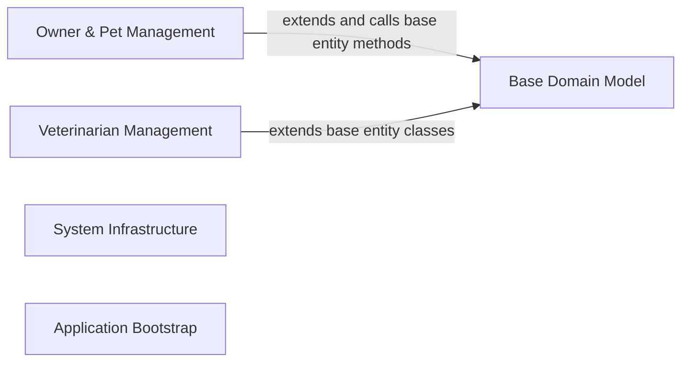

## Details

Deterministic component structure for scope root.

### Owner & Pet Management [[Expand]](./Owner_Pet_Management.md)
Domain entities, repositories, controllers, and validators for managing pet owners, their pets, visits, and pet types.

**Related Classes/Methods**:

- `src.main.java.org.springframework.samples.petclinic.owner.Owner`:50-188
- `src.main.java.org.springframework.samples.petclinic.owner.OwnerController`:49-188
- `src.main.java.org.springframework.samples.petclinic.owner.OwnerRepository`:36-62
- `src.main.java.org.springframework.samples.petclinic.owner.Pet`:46-85
- `src.main.java.org.springframework.samples.petclinic.owner.PetController`:49-207
- `src.main.java.org.springframework.samples.petclinic.owner.PetType`:28-30
- `src.main.java.org.springframework.samples.petclinic.owner.PetTypeFormatter`:37-62
- `src.main.java.org.springframework.samples.petclinic.owner.PetTypeRepository`:30-39
- `src.main.java.org.springframework.samples.petclinic.owner.PetValidator`:32-69
- `src.main.java.org.springframework.samples.petclinic.owner.Visit`:37-70
- `src.main.java.org.springframework.samples.petclinic.owner.VisitController`:43-114

**Source Files:**

- `src/main/java/org/springframework/samples/petclinic/owner/Owner.java`
  - `src.main.java.org.springframework.samples.petclinic.owner.Owner` (L50-L188) - Class
  - `src.main.java.org.springframework.samples.petclinic.owner.Owner.getAddress()` (L72-L74) - Method
  - `src.main.java.org.springframework.samples.petclinic.owner.Owner.setAddress(String)` (L76-L78) - Method
  - `src.main.java.org.springframework.samples.petclinic.owner.Owner.getCity()` (L80-L82) - Method
  - `src.main.java.org.springframework.samples.petclinic.owner.Owner.setCity(String)` (L84-L86) - Method
  - `src.main.java.org.springframework.samples.petclinic.owner.Owner.getTelephone()` (L88-L90) - Method
  - `src.main.java.org.springframework.samples.petclinic.owner.Owner.setTelephone(String)` (L92-L94) - Method
  - `src.main.java.org.springframework.samples.petclinic.owner.Owner.getPets()` (L96-L98) - Method
  - `src.main.java.org.springframework.samples.petclinic.owner.Owner.addPet(Pet)` (L100-L113) - Method
  - `src.main.java.org.springframework.samples.petclinic.owner.Owner.getPet(String)` (L120-L122) - Method
  - `src.main.java.org.springframework.samples.petclinic.owner.Owner.getPet(Integer)` (L129-L139) - Method
  - `src.main.java.org.springframework.samples.petclinic.owner.Owner.getPet(String, boolean)` (L147-L157) - Method
  - `src.main.java.org.springframework.samples.petclinic.owner.Owner.toString()` (L160-L169) - Method
  - `src.main.java.org.springframework.samples.petclinic.owner.Owner.addVisit(Integer, Visit)` (L176-L186) - Method
- `src/main/java/org/springframework/samples/petclinic/owner/OwnerController.java`
  - `src.main.java.org.springframework.samples.petclinic.owner.OwnerController` (L49-L188) - Class
  - `src.main.java.org.springframework.samples.petclinic.owner.OwnerController.OwnerController(OwnerRepository)` (L55-L57) - Constructor
  - `src.main.java.org.springframework.samples.petclinic.owner.OwnerController.setAllowedFields(WebDataBinder)` (L60-L62) - Method
  - `src.main.java.org.springframework.samples.petclinic.owner.OwnerController.findOwner(Integer)` (L65-L70) - Method
  - `src.main.java.org.springframework.samples.petclinic.owner.OwnerController.initCreationForm()` (L73-L75) - Method
  - `src.main.java.org.springframework.samples.petclinic.owner.OwnerController.processCreationForm(Owner, BindingResult, RedirectAttributes)` (L78-L87) - Method
  - `src.main.java.org.springframework.samples.petclinic.owner.OwnerController.initFindForm()` (L90-L92) - Method
  - `src.main.java.org.springframework.samples.petclinic.owner.OwnerController.processFindForm(int, Owner, BindingResult, Model, RedirectAttributes)` (L95-L130) - Method
  - `src.main.java.org.springframework.samples.petclinic.owner.OwnerController.addPaginationModel(int, Model, Page)` (L132-L139) - Method
  - `src.main.java.org.springframework.samples.petclinic.owner.OwnerController.findPaginatedForOwnersLastName(int, String)` (L141-L146) - Method
  - `src.main.java.org.springframework.samples.petclinic.owner.OwnerController.initUpdateOwnerForm()` (L149-L151) - Method
  - `src.main.java.org.springframework.samples.petclinic.owner.OwnerController.processUpdateOwnerForm(Owner, BindingResult, int, RedirectAttributes)` (L154-L171) - Method
  - `src.main.java.org.springframework.samples.petclinic.owner.OwnerController.showOwner(int)` (L179-L186) - Method
- `src/main/java/org/springframework/samples/petclinic/owner/OwnerRepository.java`
  - `src.main.java.org.springframework.samples.petclinic.owner.OwnerRepository` (L36-L62) - Interface
  - `src.main.java.org.springframework.samples.petclinic.owner.OwnerRepository.findByLastNameStartingWith(String, Pageable)` (L45-L45) - Method
  - `src.main.java.org.springframework.samples.petclinic.owner.OwnerRepository.findById(Integer)` (L60-L60) - Method
- `src/main/java/org/springframework/samples/petclinic/owner/Pet.java`
  - `src.main.java.org.springframework.samples.petclinic.owner.Pet` (L46-L85) - Class
  - `src.main.java.org.springframework.samples.petclinic.owner.Pet.setBirthDate(LocalDate)` (L61-L63) - Method
  - `src.main.java.org.springframework.samples.petclinic.owner.Pet.getBirthDate()` (L65-L67) - Method
  - `src.main.java.org.springframework.samples.petclinic.owner.Pet.getType()` (L69-L71) - Method
  - `src.main.java.org.springframework.samples.petclinic.owner.Pet.setType(PetType)` (L73-L75) - Method
  - `src.main.java.org.springframework.samples.petclinic.owner.Pet.getVisits()` (L77-L79) - Method
  - `src.main.java.org.springframework.samples.petclinic.owner.Pet.addVisit(Visit)` (L81-L83) - Method
- `src/main/java/org/springframework/samples/petclinic/owner/PetController.java`
  - `src.main.java.org.springframework.samples.petclinic.owner.PetController` (L49-L207) - Class
  - `src.main.java.org.springframework.samples.petclinic.owner.PetController.PetController(OwnerRepository, PetTypeRepository)` (L57-L60) - Constructor
  - `src.main.java.org.springframework.samples.petclinic.owner.PetController.populatePetTypes()` (L63-L65) - Method
  - `src.main.java.org.springframework.samples.petclinic.owner.PetController.findOwner(int)` (L68-L73) - Method
  - `src.main.java.org.springframework.samples.petclinic.owner.PetController.findPet(int, Integer)` (L76-L87) - Method
  - `src.main.java.org.springframework.samples.petclinic.owner.PetController.initOwnerBinder(WebDataBinder)` (L90-L92) - Method
  - `src.main.java.org.springframework.samples.petclinic.owner.PetController.initPetBinder(WebDataBinder)` (L95-L98) - Method
  - `src.main.java.org.springframework.samples.petclinic.owner.PetController.initCreationForm(Owner, ModelMap)` (L101-L105) - Method
  - `src.main.java.org.springframework.samples.petclinic.owner.PetController.processCreationForm(Owner, Pet, BindingResult, RedirectAttributes)` (L108-L137) - Method
  - `src.main.java.org.springframework.samples.petclinic.owner.PetController.initUpdateForm()` (L140-L142) - Method
  - `src.main.java.org.springframework.samples.petclinic.owner.PetController.processUpdateForm(Owner, Pet, BindingResult, RedirectAttributes)` (L145-L179) - Method
  - `src.main.java.org.springframework.samples.petclinic.owner.PetController.updatePetDetails(Owner, Pet)` (L186-L200) - Method
  - `src.main.java.org.springframework.samples.petclinic.owner.PetController.isDuplicatePetNameViolation(DataIntegrityViolationException)` (L202-L205) - Method
- `src/main/java/org/springframework/samples/petclinic/owner/PetType.java`
  - `src.main.java.org.springframework.samples.petclinic.owner.PetType` (L28-L30) - Class
- `src/main/java/org/springframework/samples/petclinic/owner/PetTypeFormatter.java`
  - `src.main.java.org.springframework.samples.petclinic.owner.PetTypeFormatter` (L37-L62) - Class
  - `src.main.java.org.springframework.samples.petclinic.owner.PetTypeFormatter.PetTypeFormatter(PetTypeRepository)` (L41-L43) - Constructor
  - `src.main.java.org.springframework.samples.petclinic.owner.PetTypeFormatter.print(PetType, Locale)` (L46-L49) - Method
  - `src.main.java.org.springframework.samples.petclinic.owner.PetTypeFormatter.parse(String, Locale)` (L52-L60) - Method
- `src/main/java/org/springframework/samples/petclinic/owner/PetTypeRepository.java`
  - `src.main.java.org.springframework.samples.petclinic.owner.PetTypeRepository` (L30-L39) - Interface
  - `src.main.java.org.springframework.samples.petclinic.owner.PetTypeRepository.findPetTypes()` (L37-L37) - Method
- `src/main/java/org/springframework/samples/petclinic/owner/PetValidator.java`
  - `src.main.java.org.springframework.samples.petclinic.owner.PetValidator` (L32-L69) - Class
  - `src.main.java.org.springframework.samples.petclinic.owner.PetValidator.validate(Object, Errors)` (L39-L59) - Method
  - `src.main.java.org.springframework.samples.petclinic.owner.PetValidator.supports(Class)` (L65-L67) - Method
- `src/main/java/org/springframework/samples/petclinic/owner/Visit.java`
  - `src.main.java.org.springframework.samples.petclinic.owner.Visit` (L37-L70) - Class
  - `src.main.java.org.springframework.samples.petclinic.owner.Visit.Visit()` (L50-L52) - Constructor
  - `src.main.java.org.springframework.samples.petclinic.owner.Visit.getDate()` (L54-L56) - Method
  - `src.main.java.org.springframework.samples.petclinic.owner.Visit.setDate(LocalDate)` (L58-L60) - Method
  - `src.main.java.org.springframework.samples.petclinic.owner.Visit.getDescription()` (L62-L64) - Method
  - `src.main.java.org.springframework.samples.petclinic.owner.Visit.setDescription(String)` (L66-L68) - Method
- `src/main/java/org/springframework/samples/petclinic/owner/VisitController.java`
  - `src.main.java.org.springframework.samples.petclinic.owner.VisitController` (L43-L114) - Class
  - `src.main.java.org.springframework.samples.petclinic.owner.VisitController.VisitController(OwnerRepository)` (L47-L49) - Constructor
  - `src.main.java.org.springframework.samples.petclinic.owner.VisitController.setAllowedFields(WebDataBinder)` (L52-L54) - Method
  - `src.main.java.org.springframework.samples.petclinic.owner.VisitController.loadPetWithVisit(int, int, Map)` (L64-L81) - Method
  - `src.main.java.org.springframework.samples.petclinic.owner.VisitController.minVisitDate()` (L84-L86) - Method
  - `src.main.java.org.springframework.samples.petclinic.owner.VisitController.initNewVisitForm()` (L91-L93) - Method
  - `src.main.java.org.springframework.samples.petclinic.owner.VisitController.processNewVisitForm(Owner, int, Visit, BindingResult, RedirectAttributes)` (L98-L112) - Method

### Veterinarian Management
Domain entities, repository, and controller for managing veterinarians and their specialties.

**Related Classes/Methods**:

- `src.main.java.org.springframework.samples.petclinic.vet.Vet`:45-74
- `src.main.java.org.springframework.samples.petclinic.vet.Specialty`:30-32
- `src.main.java.org.springframework.samples.petclinic.vet.VetController`:37-81
- `src.main.java.org.springframework.samples.petclinic.vet.VetRepository`:38-58
- `src.main.java.org.springframework.samples.petclinic.vet.Vets`:31-43

**Source Files:**

- `src/main/java/org/springframework/samples/petclinic/vet/Specialty.java`
  - `src.main.java.org.springframework.samples.petclinic.vet.Specialty` (L30-L32) - Class
- `src/main/java/org/springframework/samples/petclinic/vet/Vet.java`
  - `src.main.java.org.springframework.samples.petclinic.vet.Vet` (L45-L74) - Class
  - `src.main.java.org.springframework.samples.petclinic.vet.Vet.getSpecialtiesInternal()` (L52-L57) - Method
  - `src.main.java.org.springframework.samples.petclinic.vet.Vet.getSpecialties()` (L60-L64) - Method
  - `src.main.java.org.springframework.samples.petclinic.vet.Vet.getNrOfSpecialties()` (L66-L68) - Method
  - `src.main.java.org.springframework.samples.petclinic.vet.Vet.addSpecialty(Specialty)` (L70-L72) - Method
- `src/main/java/org/springframework/samples/petclinic/vet/VetController.java`
  - `src.main.java.org.springframework.samples.petclinic.vet.VetController` (L37-L81) - Class
  - `src.main.java.org.springframework.samples.petclinic.vet.VetController.VetController(VetRepository)` (L41-L43) - Constructor
  - `src.main.java.org.springframework.samples.petclinic.vet.VetController.showVetList(int, Model, RedirectAttributes)` (L46-L54) - Method
  - `src.main.java.org.springframework.samples.petclinic.vet.VetController.addPaginationModel(int, Page, Model)` (L56-L63) - Method
  - `src.main.java.org.springframework.samples.petclinic.vet.VetController.findPaginated(int)` (L65-L70) - Method
  - `src.main.java.org.springframework.samples.petclinic.vet.VetController.showResourcesVetList()` (L73-L79) - Method
- `src/main/java/org/springframework/samples/petclinic/vet/VetRepository.java`
  - `src.main.java.org.springframework.samples.petclinic.vet.VetRepository` (L38-L58) - Interface
  - `src.main.java.org.springframework.samples.petclinic.vet.VetRepository.findAll()` (L46-L46) - Method
  - `src.main.java.org.springframework.samples.petclinic.vet.VetRepository.findAll(Pageable)` (L56-L56) - Method
- `src/main/java/org/springframework/samples/petclinic/vet/Vets.java`
  - `src.main.java.org.springframework.samples.petclinic.vet.Vets` (L31-L43) - Class
  - `src.main.java.org.springframework.samples.petclinic.vet.Vets.getVetList()` (L36-L41) - Method

### System Infrastructure
Cross-cutting application configuration and generic system-level controllers such as caching, web setup, error handling, and the welcome page.

**Related Classes/Methods**:

- `src.main.java.org.springframework.samples.petclinic.system.CacheConfiguration`:33-53
- `src.main.java.org.springframework.samples.petclinic.system.CrashController`:29-37
- `src.main.java.org.springframework.samples.petclinic.system.WebConfiguration`:25-60
- `src.main.java.org.springframework.samples.petclinic.system.WelcomeController`:23-30

**Source Files:**

- `src/main/java/org/springframework/samples/petclinic/system/CacheConfiguration.java`
  - `src.main.java.org.springframework.samples.petclinic.system.CacheConfiguration` (L33-L53) - Class
  - `src.main.java.org.springframework.samples.petclinic.system.CacheConfiguration.petclinicCacheConfigurationCustomizer()` (L36-L38) - Method
  - `src.main.java.org.springframework.samples.petclinic.system.CacheConfiguration.cacheConfiguration()` (L49-L51) - Method
- `src/main/java/org/springframework/samples/petclinic/system/CrashController.java`
  - `src.main.java.org.springframework.samples.petclinic.system.CrashController` (L29-L37) - Class
  - `src.main.java.org.springframework.samples.petclinic.system.CrashController.triggerException()` (L32-L35) - Method
- `src/main/java/org/springframework/samples/petclinic/system/WebConfiguration.java`
  - `src.main.java.org.springframework.samples.petclinic.system.WebConfiguration` (L25-L60) - Class
  - `src.main.java.org.springframework.samples.petclinic.system.WebConfiguration.localeResolver()` (L33-L37) - Method
  - `src.main.java.org.springframework.samples.petclinic.system.WebConfiguration.localeChangeInterceptor()` (L45-L49) - Method
  - `src.main.java.org.springframework.samples.petclinic.system.WebConfiguration.addInterceptors(InterceptorRegistry)` (L56-L58) - Method
- `src/main/java/org/springframework/samples/petclinic/system/WelcomeController.java`
  - `src.main.java.org.springframework.samples.petclinic.system.WelcomeController` (L23-L30) - Class
  - `src.main.java.org.springframework.samples.petclinic.system.WelcomeController.welcome()` (L26-L28) - Method

### Base Domain Model
Shared abstract base classes providing identity and naming fields reused by owner and vet domain entities.

**Related Classes/Methods**:

- `src.main.java.org.springframework.samples.petclinic.model.BaseEntity`:33-51
- `src.main.java.org.springframework.samples.petclinic.model.NamedEntity`:31-51
- `src.main.java.org.springframework.samples.petclinic.model.Person`:29-57

**Source Files:**

- `src/main/java/org/springframework/samples/petclinic/model/BaseEntity.java`
  - `src.main.java.org.springframework.samples.petclinic.model.BaseEntity` (L33-L51) - Class
  - `src.main.java.org.springframework.samples.petclinic.model.BaseEntity.getId()` (L39-L41) - Method
  - `src.main.java.org.springframework.samples.petclinic.model.BaseEntity.setId(Integer)` (L43-L45) - Method
  - `src.main.java.org.springframework.samples.petclinic.model.BaseEntity.isNew()` (L47-L49) - Method
- `src/main/java/org/springframework/samples/petclinic/model/NamedEntity.java`
  - `src.main.java.org.springframework.samples.petclinic.model.NamedEntity` (L31-L51) - Class
  - `src.main.java.org.springframework.samples.petclinic.model.NamedEntity.getName()` (L37-L39) - Method
  - `src.main.java.org.springframework.samples.petclinic.model.NamedEntity.setName(String)` (L41-L43) - Method
  - `src.main.java.org.springframework.samples.petclinic.model.NamedEntity.toString()` (L46-L49) - Method
- `src/main/java/org/springframework/samples/petclinic/model/Person.java`
  - `src.main.java.org.springframework.samples.petclinic.model.Person` (L29-L57) - Class
  - `src.main.java.org.springframework.samples.petclinic.model.Person.getFirstName()` (L41-L43) - Method
  - `src.main.java.org.springframework.samples.petclinic.model.Person.setFirstName(String)` (L45-L47) - Method
  - `src.main.java.org.springframework.samples.petclinic.model.Person.getLastName()` (L49-L51) - Method
  - `src.main.java.org.springframework.samples.petclinic.model.Person.setLastName(String)` (L53-L55) - Method

### Application Bootstrap
Top-level Spring Boot application entry point and native-image runtime hints registration.

**Related Classes/Methods**:

- `src.main.java.org.springframework.samples.petclinic.PetClinicApplication`:30-36
- `src.main.java.org.springframework.samples.petclinic.PetClinicRuntimeHints`:25-38

**Source Files:**

- `src/main/java/org/springframework/samples/petclinic/PetClinicApplication.java`
  - `src.main.java.org.springframework.samples.petclinic.PetClinicApplication` (L30-L36) - Class
  - `src.main.java.org.springframework.samples.petclinic.PetClinicApplication.main(String[])` (L32-L34) - Method
- `src/main/java/org/springframework/samples/petclinic/PetClinicRuntimeHints.java`
  - `src.main.java.org.springframework.samples.petclinic.PetClinicRuntimeHints` (L25-L38) - Class
  - `src.main.java.org.springframework.samples.petclinic.PetClinicRuntimeHints.registerHints(RuntimeHints, ClassLoader)` (L28-L36) - Method

### [FAQ](https://github.com/CodeBoarding/GeneratedOnBoardings/tree/main?tab=readme-ov-file#faq)